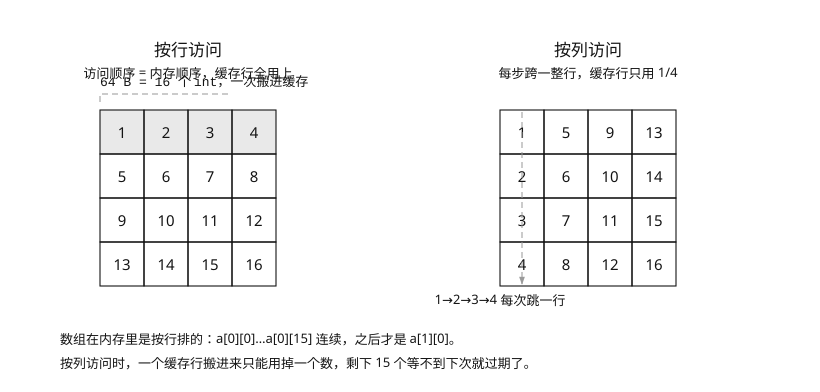

## 主诉

大一的程序设计课有个经典作业：给一个 n×n 矩阵求和。有个同学写了两层循环，内层走行、外层走列，跑 4000×4000 要七秒多。他以为自己算法写错了，把代码发给我看。

我一行没改，只把两个循环的位置对调，同一次运行变成 0.13 秒。他不信，说这不可能，逻辑是一样的。

逻辑确实一样，加法交换律嘛。不一样的是一共从内存里搬了多少个缓存行。

## 化验

```c
#include <stdio.h>
#include <time.h>

#define N 4000
int a[N][N];

int main(void)
{
    int i, j;
    long long s1 = 0, s2 = 0;
    clock_t t0, t1;

    for (i = 0; i < N; ++i)
        for (j = 0; j < N; ++j)
            a[i][j] = i + j;

    t0 = clock();
    for (i = 0; i < N; ++i)
        for (j = 0; j < N; ++j)
            s1 += a[i][j];
    t1 = clock();
    printf("按行 = %.3f 秒 (sum=%lld)\n", (double)(t1 - t0) / CLOCKS_PER_SEC, s1);

    t0 = clock();
    for (j = 0; j < N; ++j)
        for (i = 0; i < N; ++i)
            s2 += a[i][j];
    t1 = clock();
    printf("按列 = %.3f 秒 (sum=%lld)\n", (double)(t1 - t0) / CLOCKS_PER_SEC, s2);
    return 0;
}
```

我这台机器上（`-O2`，连续跑三次取最好一次）：

```text
N=4000  按行 = 0.008 秒   按列 = 0.131 秒   比值 = 15.3
```

`a` 是 4000×4000 个 `int`，一共 64 MB，远超这颗 CPU 的三级缓存。同样 400 万次加法，一个 8 毫秒，一个 131 毫秒。

顺手说个对照：把 N 改成 2000，数组变成 16 MB，比值只剩 3 倍左右。数据小到能整块装进缓存时，顺序几乎不重要。**缓存问题只在数据集超过缓存容量时才显形**，这也是为什么很多人本地测小数据看不出问题。

## 诊断：内存是一车一车搬的，不是一字节一字节取的

CPU 读内存以**缓存行（Cache Line）**为单位，一行 64 字节，正好 16 个 `int`。你只要碰了 `a[i][0]`，硬件就把 `a[i][0]` 到 `a[i][15]` 一起搬进 L1。



C 语言的多维数组按**行主序**存储：`a[0][0]` 到 `a[0][3999]` 是连续的 16000 字节，然后才是 `a[1][0]`。

按行遍历时，访问顺序正好等于内存顺序。每搬一次 64 字节，接下来 15 次加法全都命中缓存，等于白送。

按列遍历时，第一步取 `a[0][0]`，搬进来 64 字节，只用了其中 4 字节。第二步跳到 `a[1][0]`，地址一下跨了 16000 字节，缓存行里剩的 15 个 `int` 一个也用不上。下次再回来找 `a[0][1]`，那一行早被挤出 L1 了。

算一笔账：按列遍历每 16 次访问才用掉 1 个缓存行，理论上要多搬 16 倍的数据。实测 15 倍，和理论对得上。之所以不是 16 倍整，是因为 L2/L3 帮了一点忙，硬件的预取器也能猜到你在跨步访问。

## 三处你每天都在写的地方

**二维数组的遍历顺序。** 只要内层循环对应的是最右边的下标，就是好的；反过来就是坏的。三维数组同理，内层要走最后一维。

**结构体数组（AoS）与拆分数组（SoA）。** `struct Point { double x, y, z; }` 的数组，只想遍历 `x` 时会把 `y`、`z` 一起搬进缓存；拆成三个数组各存一列，利用率立刻上升。这就是做数据布局时的 AoS/SoA 之争。

**链表。** 链表的每个结点是单独 `malloc` 的，物理地址可能满地都是。遍历一千个结点就是一千次随机访问，缓存几乎帮不上忙。同样的数据用数组存，顺序扫描快一个数量级。**这就是为什么很多算法用数组模拟链表**，也是 `std::vector` 在现代 CPU 上比 `std::list` 快的原因。

## 处方

1. 内层循环尽量遍历连续内存。二维数组按行，三维数组按最后一维，这是免费的优化。
2. 大矩阵乘法和卷积做分块（tiling），把一个小方块放进缓存里反复用，能再快两三倍。
3. 需要频繁顺序扫描的数据，优先数组而不是链表。只有当中间插入删除远多于遍历时，链表才划算。
4. 别指望 `-O2` 帮你重排循环。编译器可以交换不相关的循环，但涉及全局数组和浮点累加时，它不敢乱动。
5. 测性能要造出真实规模的数据。小数据测出来的时间差经常在噪声里。

## 复诊

这条病例和 [第 6 章 · 数组](/cbook/06-shuzu.html) 是同一件事的两面：那边讲下标怎么写对，这边讲下标怎么写快。第 6 章里那道"走迷宫"如果用二维数组存地图，BFS 的队列顺序其实也影响速度。

下一篇回到内存本身，讲**为什么没赋值的变量会打印出奇怪的东西**。缓存讲的是取数据快不快，下一篇讲的是取到的到底是谁的数据。
