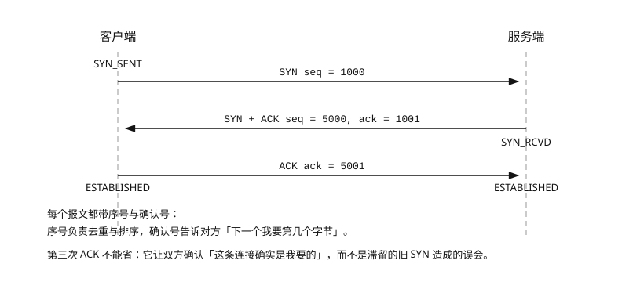

## 主诉

调试一个客户端，`connect` 一直失败。报错有两种，交替出现：

一种是"卡两秒，然后连接被拒绝"；另一种是"卡二十秒，超时"。

看起来都是"连不上"，我一开始也当成同一件事处理，改了半天代码没进展。后来抓包才明白，这两种情况在网络上发生的事完全相反：一个收到了明确的拒绝，另一个连个回音都没有。

## 化验

```c
#include <stdio.h>
#include <winsock2.h>

static void try_connect(const char *ip, int port)
{
    SOCKET s = socket(AF_INET, SOCK_STREAM, 0);
    struct sockaddr_in a;
    a.sin_family = AF_INET;
    a.sin_port = htons((unsigned short)port);
    a.sin_addr.s_addr = inet_addr(ip);

    DWORD t0 = GetTickCount();
    int r = connect(s, (struct sockaddr *)&a, sizeof(a));
    DWORD dt = GetTickCount() - t0;

    printf("连接 %s:%d -> 返回 %d，耗时 %lu ms，错误码 %d\n",
           ip, port, r, dt, r == 0 ? 0 : WSAGetLastError());
    closesocket(s);
}

int main(void)
{
    WSADATA wsa;
    WSAStartup(MAKEWORD(2, 2), &wsa);
    try_connect("127.0.0.1", 9999);    /* 本机，没有程序监听 */
    WSACleanup();
    return 0;
}
```

实测：

```text
连接 127.0.0.1:9999 -> 返回 -1，耗时 2016 ms，错误码 10061
```

`10061` 是 `WSAECONNREFUSED`，连接被拒绝。如果换成一台不可达的 IP，会得到 `10060`（`WSAETIMEDOUT`，超时），耗时通常二十秒以上。

两个错误码，两种完全不同的网络行为。

## 诊断：三次握手在握什么

TCP 建立连接要交换三个报文：



第一个报文 `SYN`，客户端说：我想连你，我的起始序号是 1000。此时客户端进入 `SYN_SENT`。

第二个报文 `SYN+ACK`，服务端说：收到，我的起始序号是 5000，我确认你的 1000（下一个我要 1001）。服务端进入 `SYN_RCVD`。

第三个报文 `ACK`，客户端说：收到你的 5000，下一个我要 5001。双方进入 `ESTABLISHED`，可以传数据了。

序号不是为了数数，是为了**去重和排序**：网络会重复、会乱序、会丢，接收方靠序号判断这个包是新的还是老的。

**为什么不是两次？** 如果服务端发完 `SYN+ACK` 就认为连上了，那么一个在网络里滞留很久的旧 `SYN` 到达时，服务端会建立一个实际上没人用的连接，白占资源。第三次 `ACK` 的存在，是让客户端确认"我确实想要这个连接"。

## 拒绝与超时，差别在有没有人回话

**连接被拒绝（RST）**：报文到达了对端，但对端在这个端口上没有监听，内核直接回一个 `RST`。客户端收到，立刻返回 `ECONNREFUSED`。

所以"拒绝"是个好消息，它说明**网络通、主机在、只是服务没起**。排查方向是服务端：进程挂了吗，端口对吗，绑的是 127.0.0.1 还是 0.0.0.0？

**超时（丢包）**：`SYN` 发出去，没有任何回应。可能是防火墙 `DROP` 了（不是 `REJECT`），可能是路由不通，可能是主机不在线。客户端重发几次 `SYN`，每次间隔翻倍，最后放弃，返回 `ETIMEDOUT`。

"超时"意味着你连"对方是否存在"都无法确认，排查方向在链路上。

这两种情况的处理策略完全不同：拒绝要改配置，超时要加超时、加重试、换线路。

## 一个常被忽略的细节：SYN 队列

服务端收到 `SYN` 后，会把它放进一个半连接队列，等第三次 `ACK` 到了才移到全连接队列。队列长度由 `listen(s, backlog)` 的 `backlog` 决定。

如果队列满了，新的 `SYN` 会被丢掉（或者按系统配置回 `RST`）。表现就是：服务端明明在跑，压测时却有一批连接超时。这不是代码 bug，是 `backlog` 太小。

```c
listen(s, SOMAXCONN);    /* 用系统允许的最大值，别写 1 */
```

写过 socket 作业的人应该记得，`backlog` 写 1 的时候，第二个客户端就连不上了。

## 处方

1. 按错误码分流。`ECONNREFUSED` 查服务端，`ETIMEDOUT` 查网络和防火墙，别混着猜。
2. `connect` 要有超时。默认超时动辄二十秒，界面会像卡死。Windows 用非阻塞 `connect` 加 `select`，Linux 同理。
3. 重试要退避。连续重连时加指数退避，别一秒一次把服务端打垮。
4. `backlog` 用 `SOMAXCONN`，不是 1。
5. 排查靠抓包。Wireshark 里看 `SYN` 有没有发出、有没有 `SYN+ACK` 回来、有没有 `RST`，三眼就能定性。

## 复诊

这个系列到这里正好十篇。从栈、补码、浮点、对齐、缓存、未初始化、编译链接、栈帧，一路走到端口和握手，症状各不相同，但方法是一样的：**先让现象可测，再找机制，最后落成习惯**。

想继续往下看的话，[C 语言例题册](/cbook/) 那边是"怎么写对"，[芯片入门](/icbook/) 那边是"硬件怎么把它做出来"。这三条线合起来，基本能覆盖"从一行代码到一台机器"的全过程。

下一篇如果要排，我会写**线程与锁：为什么加了锁还是出错**，那是这条路上最后一段没讲的地方。
