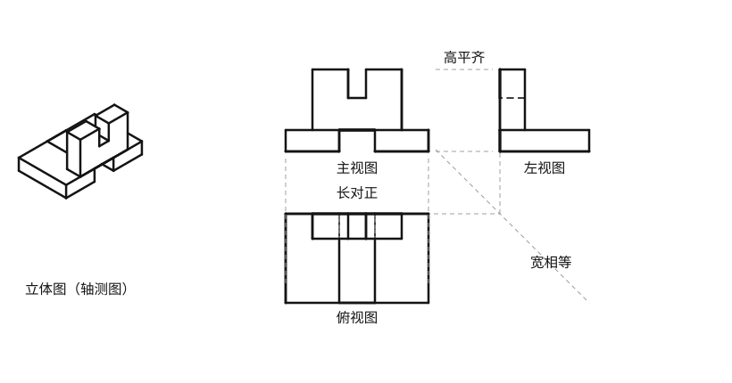

工程制图看着花样很多，考试却相当死板。把近几年的卷子摊开看，题型和分值几乎一模一样：

| 题号 | 题型 | 分值 | 考什么 |
| --- | --- | --- | --- |
| 一 | 选择 | 10 | 投影性质、截交相贯、尺寸标注、断面图的正误判断 |
| 二 | 补投影 | 11 | 平面上取点取线，保留作图过程 |
| 三 | 补第三投影 | 16 | 立体被切割后的 H 面（或 V 面）投影 |
| 四 | 补视图 | 22 | 已知两视图补第三视图，**包括虚线** |
| 五 | 标注尺寸 | 16 | 按 1:1 量取整数，标注组合体尺寸 |
| 六 | 剖视图 | 25 | 主视图全剖、左视图半剖 |

后四道题占 79 分，全是手上功夫。所以这门课的复习重点不是「理解」，而是**画对**——线条、虚线、剖面线、尺寸，一个都不能少。

## 一切从三视图开始

立体只有一个，视图有三张。把物体放在三个互相垂直的投影面之间，分别向三个面投影，再把面展开摊平，就得到三视图：

<figure class="fig">
  
  <figcaption>图 1-1　三视图的形成。同一形体，轴测图给直觉，三视图给尺寸</figcaption>
</figure>

三张图之间靠三条规律绑定，这三个字必须刻进手里：

- **长对正**：主视图与俯视图左右对齐，长度方向一致；
- **高平齐**：主视图与左视图上下对齐，高度方向一致；
- **宽相等**：俯视图的上下宽度 = 左视图的左右宽度，靠一条 45° 斜线转过去。

还有一条位置关系，很多人临到考试才发现自己记反了：**俯视图、左视图靠近主视图的一侧，是物体的后面；远离主视图的一侧，是物体的前面。** 记住「近处是后，远处是前」，看图时先找前后面，立体感会立刻清楚一大半。

## 五种线，各有各的活

判卷老师第一眼看的就是线型，线型错了，图形再对也要扣分：

| 线型 | 用途 | 画法 |
| --- | --- | --- |
| 粗实线 | 可见轮廓线 | 约 0.7 mm，全图最粗 |
| 细虚线 | 不可见轮廓线 | 约 0.35 mm，画 4 空 1，线段长度一致 |
| 细点划线 | 轴线、对称中心线 | 长画短间隔，两端超出轮廓 2~5 mm |
| 细实线 | 尺寸线、尺寸界线、剖面线、作图线 | 约 0.35 mm |
| 波浪线 | 局部剖的断裂边界 | 徒手画，不要用尺 |

两条纪律：**虚线该画必须画**（第四题明确要求「包括虚线」），**被切掉的部分一根线也不能留**（截切题最常见的失分点）。

## 怎么练才有用

这门课有个很坑的特点：看懂答案会产生「我会了」的错觉。检验标准只有一个——**给你两个视图，你能不能在没有答案的情况下把第三张画出来**。

所以练的时候按这个顺序来：

1. **先分块**：把复杂形体拆成棱柱、棱锥、圆柱、圆锥、球这几个基本体的加减组合；
2. **再对投影**：一个视图上的每个实线框，都要在另外两个视图里找到对应的线段；
3. **最后落笔**：先画外形轮廓，再补内部结构，最后统一检查虚线与擦除。

如果空间想象实在吃力，可以拿 SolidWorks 之类的软件把形体建一遍，转着看几次，比盯着图看一小时有用。但**考试是手绘**，建模只是帮你建立直觉，不能代替画图训练。

## 自查清单

- 能不能在不看图的情况下，说出「长对正、高平齐、宽相等」分别约束哪两个视图？
- 俯视图的上边对应物体的前面还是后面？左视图的左边呢？
- 五种线型各自出现在什么场合？虚线画多长、空多宽？
- 拿到一道补视图题，你的第一步动作是什么？（答案：找实线框，分块）
