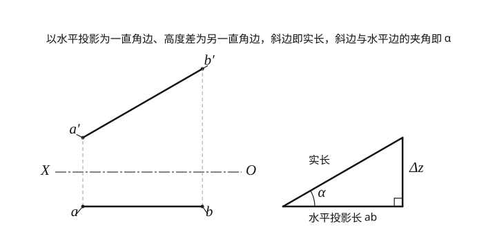
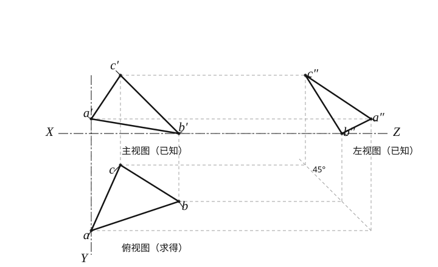

三视图画得准不准，取决于两件小事：**点的投影对不对得上，直线的实长会不会求**。第二题「补投影（保留作图过程）」考的就是这些。

## 一个点，三条规矩

点是最小的单位，它的投影只有三条规矩，但每年都有人错：

1. 正面投影与水平投影的连线**垂直于 OX 轴**（长对正）；
2. 正面投影与侧面投影的连线**垂直于 OZ 轴**（高平齐）；
3. 水平投影到 OX 轴的距离 = 侧面投影到 OZ 轴的距离（宽相等）。

第三条最容易丢。作图时用一条 45° 斜线把「宽」从俯视图转到左视图，转的时候画细实线，别用粗线。

## 直线：什么时候是实长

一条直线投影下来，通常比实际短——只有在**平行于某个投影面**时，它在该面上的投影才是实长。所以判断一道题能不能直接量，看它是不是特殊位置直线：

- **投影面平行线**：水平线（∥H）、正平线（∥V）、侧平线（∥W），各自在对应的投影面上反映实长，同时反映与另外两个面的倾角；
- **投影面垂直线**：铅垂线（⊥H）、正垂线（⊥V）、侧垂线（⊥W），投影积聚成一个点；
- **一般位置直线**：三个投影都短于实长，也不会直接告诉你倾角。

一般位置直线的实长，用**直角三角形法**求：

<figure class="fig">
  
  <figcaption>图 2-1　以水平投影为直角边、高度差为另一直角边，斜边就是实长</figcaption>
</figure>

只有一句话要记：**以某个投影为一直角边，以两端点在垂直于该投影面方向上的坐标差为另一直角边，斜边即实长。** 斜边与这条投影边的夹角，就是直线对该投影面的倾角。

求 α（与 H 面的夹角）就用水平投影 `ab` 和 `Δz`；求 β（与 V 面的夹角）就用正面投影 `a′b′` 和 `Δy`。用错坐标差是这一步最常见的错，画之前先在图上把两个端点的 `z`（或 `y`）标出来。

## 直角投影定理：判断垂直的捷径

空间里两条直线垂直，如果其中有一条**平行于某个投影面**，那么它们在该投影面上的投影仍然是直角。

这条定理几乎每年都用：判断两直线是否垂直、求点到直线的距离、作垂线，都是先找那条「平行于投影面」的线，再在对应视图里画 90°。反过来，如果两条线的某个投影成直角，但两条线都不平行于该投影面，那么这个直角**不能**直接当成空间垂直。

## 平面上取点取线

点在平面上，等价于点在平面内的一条直线上。所以「面上取点」的固定套路是：

1. 过已知点作一条属于该平面的辅助线（通常取与投影轴平行的方向，好画）；
2. 先把这条辅助线的三面投影补全；
3. 点必然落在辅助线的同名投影上——按投影规律量过去即可。

「保留作图过程」这句话就是让你把这些辅助线留下来，别擦。判卷看的就是辅助线对不对。

## 例题：补画平面图形的水平投影

已知一个平面图形 ABC 的正面投影和侧面投影，求水平投影。

<figure class="fig">
  
  <figcaption>图 2-2　先用投影规律把三个点的 H 投影求出来，再连线；虚线是作图过程，要保留</figcaption>
</figure>

做法只有三步：

1. **求点**：`a′` 向下引垂线，`a″` 向右引水平线，两者交点所在的竖直线上取宽相等的位置，得到 `a`；`b`、`c` 同理；
2. **连面**：按原来的连接顺序把 `a、b、c` 连起来，闭合；
3. **查**：三角形的三个顶点顺序不能在展开后被打乱（尤其是侧平面积聚成一条线的情况），连完对着 `V`、`W` 面核对一次形状是否「像」。

这道题分值不高但性价比极高：只要投影规律没记反，基本稳拿。丢分的人多半是把 45° 线的方向画反，或者把 `a` 和 `a″` 的宽弄混——**俯视图向下量，左视图向左量**，两边量的都是「宽」。

## 自查清单

- 点的三面投影，哪两条连线必须垂直投影轴？哪两个距离必须相等？
- 一般位置直线求实长，直角三角形的两条直角边分别是什么？
- 直角投影定理成立的前提是什么？
- 面上取点，辅助线应该怎么选才省事？
- 补第三投影时，45° 线的作用是什么？画粗了会怎样？
