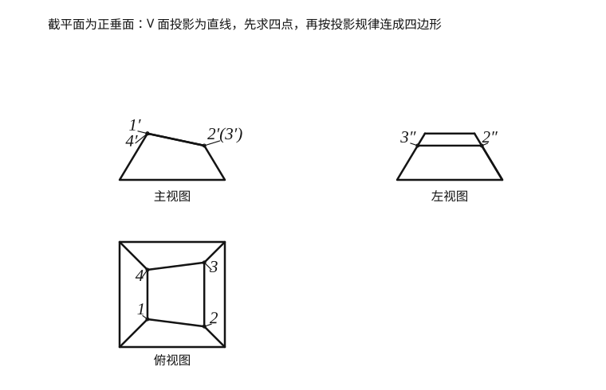
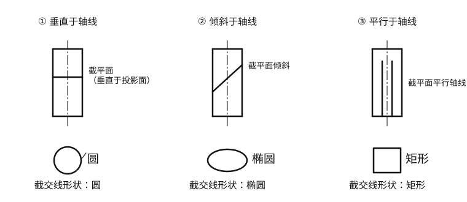
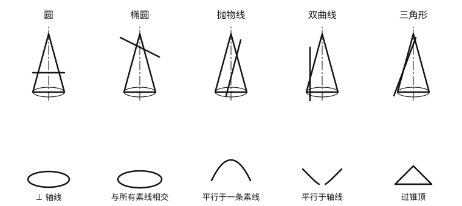
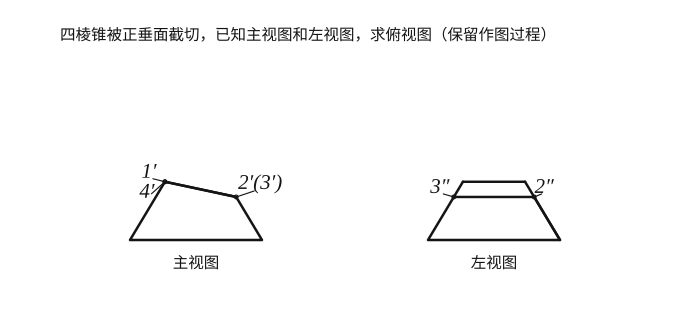

从这一章开始，题目开始「长牙」了：一个好好的圆柱被斜着切一刀，要求你补出另一个视图。切出来的那道线叫**截交线**，它的本质只有一句话——**截平面与立体表面的公共线**。

既然是公共线，线上的每个点都同时满足两个条件：在截平面上，也在立体表面上。所以求截交线永远是同一个动作：**找点，连线**。

## 通用四步

1. **找特殊点**：棱线（或素线）与截平面的交点、最高最低点、最左最右点、转向轮廓线上的点。特殊点决定了曲线的骨架；
2. **补一般点**：两个特殊点之间如果跨得远，中间再取 1~2 个点，曲线才不会画瘪；
3. **顺次连线**：按立体表面上的连接顺序连，不能跳着连；
4. **判可见性**：位于可见表面上的线段画粗实线，被挡住的部分画虚线；同时把**被截去那部分的轮廓线擦掉**。

第四步是失分重灾区。截切后的形体已经「少了」一块，原来锥顶、柱顶的轮廓线不该再出现。

## 棱柱、棱锥：把棱线当尺子

平面立体的截交线一定是多边形，顶点就是棱线与截平面的交点。所以只要把每一条棱与截平面的交点求出来，按顺序连起来即可。

<figure class="fig">
  
  <figcaption>图 3-1　正垂面截四棱锥：V 面投影积聚成一条直线，四个交点求出后按棱的顺序连线</figcaption>
</figure>

这道题的关键在于**截平面是正垂面**——它垂直于 V 面，所以在主视图上积聚成一条斜线。于是：

- 主视图：截交线就是那条斜线，四条棱与它的交点记为 `1′、2′、3′、4′`；
- 俯视图：把四个点按「长对正」投影到对应的棱上，得到 `1、2、3、4`，连成四边形；
- 左视图：按「高平齐、宽相等」定出 `1″、2″、3″、4″`，连成四边形。

注意左视图的外形是**六边形**（底边两点 + 截口四点），而不是简单的梯形——很多人在这里只画了外形轮廓，忘了截口本身就是轮廓的一部分。

## 圆柱：三种情况，背下来

圆柱被平面截切，只有三种可能，取决于截平面与轴线的相对位置：

<figure class="fig">
  
  <figcaption>图 3-2　垂直于轴线得圆，倾斜得椭圆，平行于轴线得矩形</figcaption>
</figure>

| 截平面与轴线 | 截交线 | 投影特点 |
| --- | --- | --- |
| 垂直 | 圆 | 在垂直于轴线的视图上为圆，另两个视图积聚成直线 |
| 倾斜 | 椭圆 | 倾斜的那个视图上为椭圆，需要取点描线 |
| 平行 | 矩形（两条素线） | 两端是直线，切口宽度等于弦长 |

考试里最常见的是椭圆，而且**很少给你完整的椭圆**：截平面只切掉圆柱的一部分，留下的是椭圆的一段弧。判断留下哪一段的方法很朴素——看截平面实际切到了哪几条素线，把交点标出来，弧自然就定界了。

画椭圆时别指望手画四段圆弧拼，老老实实取点：至少取 5 个（两端点 + 最高点 + 两个中间点），用细实线轻轻连，确认形状后再描粗。

## 圆锥：五种情况，考双曲线

圆锥是这门课里截交线最花样的立体，因为截平面与素线的相对位置有五种：

<figure class="fig">
  
  <figcaption>图 3-3　圆、椭圆、抛物线、双曲线、三角形（过锥顶时退化为两条相交直线）</figcaption>
</figure>

判断口诀：**拿截平面与轴线的夹角 β，去和圆锥的半顶角 α 比**。

- β = 90°，垂直于轴线 → 圆；
- β > α，与所有素线都相交 → 椭圆；
- β = α，平行于某一条素线 → 抛物线；
- β < α，比素线更「陡」地竖切（极端情况是平行于轴线）→ 双曲线；
- 过锥顶 → 两条相交直线。

C 课最常考的是**双曲线**：截平面竖直切下去，切出来的两条曲线在俯视图上是双曲线的两支，在主视图上积聚成一条竖直线。抛物线次之。这两种曲线都得靠取点描，取点时要特别注意**转向轮廓线上的点**——它决定了曲线在视图里的最外侧位置。

## 球：永远是圆

球被任何平面截切，截交线都是圆。但投影下来可能是圆、椭圆或一条直线，取决于截平面与投影面的关系：

- 截平面平行于某投影面 → 在该视图上是圆的实形；
- 倾斜 → 投影为椭圆，长短轴要自己定；
- 垂直于某投影面 → 在该视图上积聚成直线。

求球面上点的投影用**辅助平面法（纬圆法）**：作一个垂直于轴线的辅助平面，它与球面的交线是一个圆，这个圆在俯视图上是实形，可以量半径。这个方法也适用于圆锥、圆柱上的取点。

## 动手画一题

<figure class="fig">
  
  <figcaption>先自己在纸上把俯视图画出来，保留作图线，再展开对照</figcaption>
</figure>

  
画完了？展开对照答案

<figure class="fig">
  
</figure>

1. 在**主视图**上标出截平面（这里积聚成一条斜线）与四条棱的交点 `1′、2′、3′、4′`；
2. 按「长对正」把 `1′、2′` 投到俯视图的对应棱 SA、SB 上，得到 `1、2`；
3. `3′、4′` 在背面，俯视图上取对称位置的 `3、4`（它们在棱 SC、SD 上）；
4. 顺次连成四边形 `1-2-3-4`，检查四个点确实落在四条棱的投影上；
5. 擦掉**被截去的那部分**轮廓线（原来的锥顶），保留作图线。

## 自查清单

- 截交线的定义是什么？为什么说「求截交线 = 找点连线」？
- 特殊点包括哪几类？为什么必须先找它们？
- 圆柱三种截交线分别对应截平面什么位置？
- 圆锥的抛物线、双曲线，判断依据是截平面与什么的相对位置？
- 截切之后，哪些线必须擦掉？哪些虚线必须补上？
