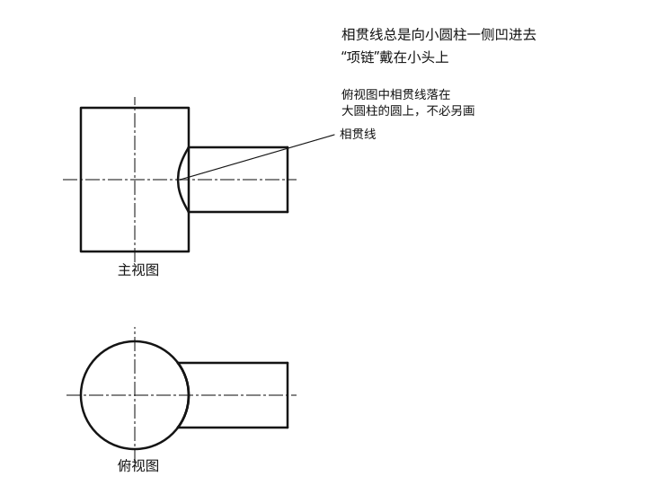
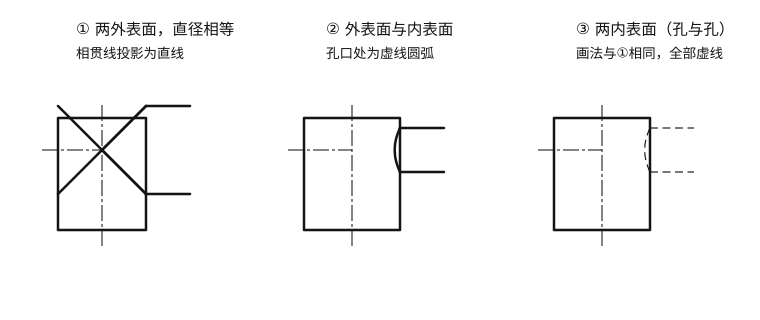

截交线是「一刀切」，相贯线是「两个立体互相长在一起」。它比截交线更让人头疼，因为曲线两头都悬空，还经常被内部的孔洞搅乱。

但它的逻辑跟截交线完全一样：相贯线是**两立体表面的公共线**，求法还是**找点、连线**。区别只在于——点不再来自棱线，而要自己在两个曲面上「对」出来。

## 两圆柱正交：一条弦的规矩

这是最常见、也是最好背的一种：大圆柱直立，小圆柱水平从侧面插进来。

<figure class="fig">
  
  <figcaption>图 4-1　相贯线在俯视图上落在大圆柱的圆上，主视图上是向内凹的一段曲线</figcaption>
</figure>

三条结论直接背：

1. **相贯线总是向小圆柱一侧凹**——俗称「项链戴在小头上」。大圆柱上开小孔，曲线就朝孔的方向弯；
2. **俯视图里，相贯线与大圆柱的圆重合**，不用另画。因为相贯线就在大圆柱表面上，从上往下看当然落在圆上；
3. **主视图里，相贯线的最高点、最低点落在小圆柱的转向轮廓线上**，这两个点是画曲线的骨架，先定它们再取中间点。

取点的方法：在小圆柱上取一系列素线（相当于取不同的 `y`），每条素线与大圆柱表面的交点，就是相贯线上的点。这也是「表面取点法」的标准做法。

## 三种情形，一套画法

相贯的两方可以是外表面，也可以是内表面（孔）。一共有三种组合，画法其实一模一样，只是虚实不同：

<figure class="fig">
  
  <figcaption>图 4-2　等径时相贯线退化成直线；内表面的画法与外表面完全相同，只是全为虚线</figcaption>
</figure>

- **两外表面**：实线曲线，最常见；
- **外表面与内表面**（例如大圆柱外表面与小孔）：曲线一部分是实线、一部分是虚线，取决于那一段是否可见；
- **两内表面**（孔与孔相交）：全部虚线。

还有一条特例值得单独记：**两圆柱直径相等且轴线相交时，相贯线在视图上退化为直线**。所以看到「等径正交」，不要画曲线，直接画两条 45° 斜线。这条在选择题里考得很多。

## 复杂相贯线的拆法

考试里的图形很少是「一个圆柱插一个圆柱」，更常见的是一个大形体上开了好几个口。看着吓人，拆开就三步：

1. **先外外**：把所有外表面与外表面的相贯线画出来，构成主体骨架；
2. **再内内**：内部的孔与孔如果相交，也有一条相贯线，通常画虚线；
3. **最后补「创伤」**：内孔穿出外表面时，会在外表面上撕出一个口子，这个口子与外表面的交线就是新的相贯线——也就是说，**内孔的存在会让外表面多出线来**。

举个典型的：圆柱上开了一个横向通孔。这个孔在内表面自己有轮廓线（虚线），同时孔的边缘与大圆柱外表面相交，多出两条相贯线（实线）。很多人只画了虚线孔，忘了外面那两条弧，直接丢一半分。

## 三个高频模型

近几年的题目反复出现三种「局部结构」，认识它们能省很多时间：

| 结构 | 特征 | 画法要点 |
| --- | --- | --- |
| 圆柱上开圆孔 | 孔口是圆，孔壁与圆柱外表面相交 | 两条相贯线向孔内凹，孔壁虚线 |
| 圆柱上开通槽 | 槽两侧是直素线，槽底是平面 | 上口是直线切口，下口是相贯线弧，两端各有一段 |
| 棱柱与回转体相贯 | 平面切割曲面，交线是直线 + 曲线 | 直线部分直接连，曲线部分取点描 |

通槽这一类特别容易画错的地方是**槽的两端**：槽不是无限长的，它在大圆柱表面上有一个「出口」，出口处的交线是曲线而不是直线。先想清楚槽从哪里进去、从哪里出来，再决定哪一段该弯。

## 自查清单

- 相贯线朝哪个方向凹？如果小圆柱在内侧（孔）呢？
- 为什么俯视图里相贯线不用另画？
- 等径正交时相贯线是什么形状？为什么？
- 内孔穿出外表面时，外表面为什么会多出线？
- 通槽题里，哪几条线是直线、哪几条是曲线？
