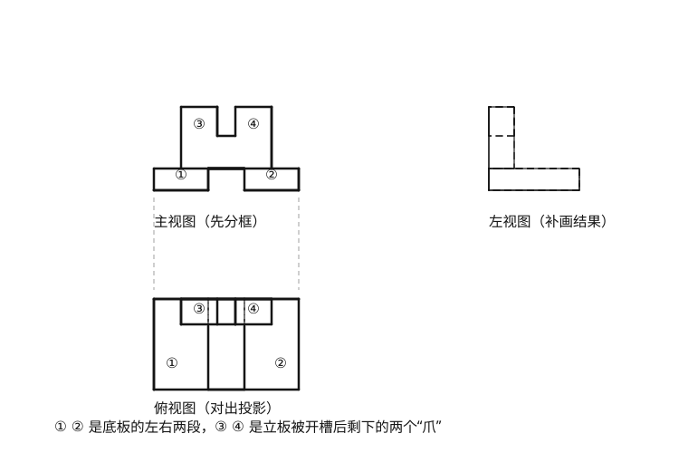
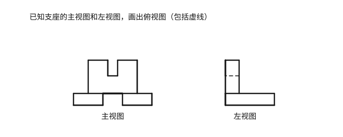

第四题 22 分，是全卷最值钱的一道题：**已知两个视图，补画第三个视图，包括虚线**。

这道题不考计算，只考你能不能把两个视图「合成」成一个立体，再把它转个方向。所以它的难点不在画，而在**想**。想不出来的时候，用固定流程硬推，比干瞪着图有效。

## 四步法

1. **分框**：在主视图上用实线框把形体分成几块。一个封闭的实线框，通常对应一个平面或一个基本体；
2. **对投影**：把每个框按「长对正」投到俯视图上，找到它占据的范围；反过来也一样；
3. **想象**：一块一块想清楚它是什么形状、有多深、在上面还是在下面；
4. **补画**：按投影关系把第三视图画出来——先画外形，再画内部，最后检查虚线。

<figure class="fig">
  
  <figcaption>图 5-1　主视图分成四块，俯视图上找到各自的投影，再逐块补出左视图</figcaption>
</figure>

这个支座可以这样读：底板是一块 80×50×12 的板，底部中间挖了一条通槽（俯视图上左右两段底板 ①②，槽的两壁在左视图里是看不见的，不产生线）；后面立着一块薄板，顶部又开了一个槽，剩下左右两个「爪」③④。左视图里那条虚线，就是立板槽底的高度——它在左视图方向被立板自己挡住了。

## 线面分析法：判断深度

有些形体光靠「分块」想不出来，因为它的各个面都是投影面平行面，没有斜线可依。这时候用**线面分析法**，核心是判断每个面的**深度层次**：

- 一个视图上的实线框，代表一个面；
- 这个面在另一个视图上对应一条线段，线段的**位置**就说明了它的深度；
- 如果有圆孔，圆孔在另一个视图上通常表现为虚线，虚线的长度就是孔的深度。

一条实战经验：**当几个面在视图上全是实线、难以判断前后时，看「创口」——被挖得更狠的那个面通常在前面**。比如方形槽和圆孔重叠，方形在前、圆形在后，因为在俯视图上方形轮廓完整、圆被切断了。

另一条：**在圆视图上，直径画成实线，说明这里有一个完整的半圆或整圆存在**；画成虚线，说明这个圆被挡住了。同一个图形里如果出现「完整圆 + 打孔」「半圆 + 打孔」「被削掉大半圆」三种情况叠在一起，就要按从内到外的顺序一层层剥。

## 补第三视图的顺序

画的时候按这个顺序，不容易乱：

1. **外形轮廓**：最高、最宽、最深的轮廓线先定住，这是骨架；
2. **可见结构**：能直接看到的台阶、槽口、凸台；
3. **内部结构**：孔、内腔，先按投影关系定位，再决定实线还是虚线；
4. **擦除**：被挡住的线不要画，被切掉的线必须删；
5. **复核**：拿第三视图和另外两个视图对一遍——每条线都要能解释「它是什么面的投影」。

最后一步最容易被跳过，但它能救回不少分。具体做法：手指点着左视图上的每一条线，问自己「这是哪个面的边」。解释不出来的线，多半是多画的；找不到对应线的面，多半是漏画的。

## 动手画一题

<figure class="fig">
  
  <figcaption>这道题只有两个视图，宽度要从左视图自己转过去；画完记得补虚线</figcaption>
</figure>

  
画完了？展开对照答案

<figure class="fig">
  
</figure>

1. 主视图分成四块：底板左右两段 ①②，立板开槽后的两个「爪」③④；
2. 俯视图上底板是一条 80×50 的矩形，槽从下边（前面）切进去，槽壁是两条竖直实线；
3. 立板贴在底板后侧，所以它的投影落在俯视图的上方，槽口朝前；
4. 立板槽底的高度比底板高，从上面看**看不到**，所以在俯视图上画**虚线**；
5. 检查三条：宽度与左视图一致、虚线有没有漏、被遮住的线有没有多画。

## 常见失分点

- 虚线漏画。题目明确写了「包括虚线」，内部结构一个都不能少；
- 把不可见的轮廓画成实线。判断标准是：从该视图的观察方向看过去，这条边前面有没有实体挡着；
- 三个视图的宽度对不上。左视图的宽度必须等于俯视图的宽度，画完量一遍；
- 忘了 45° 线。补第三视图时，宽度是从俯视图经 45° 线转过去的，不用 45° 线容易错位。

## 自查清单

- 四步法里，「分框」分的是什么？为什么一个实线框通常对应一个面？
- 判断面的前后，除了看投影长度，还有什么经验？
- 圆孔在另一个视图上为什么是虚线？虚线长度代表什么？
- 补完第三视图，怎么用「每条线都能解释」来查错？
