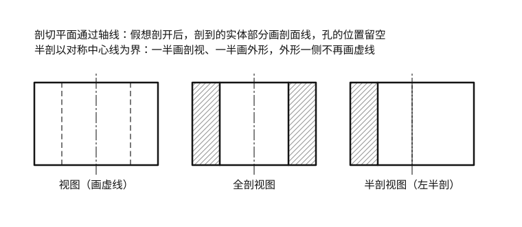

第六题 25 分，是整张卷子里分值最高的一题：**主视图画成全剖视，左视图画成半剖视**。

它的思路其实很反直觉：剖视图不是「多画」，而是「**少画**」——把挡在前面的材料拿掉，让内部结构露出来，于是那些烦人的虚线消失了，图反而变干净。

## 剖视图是怎么来的

假想用一个剖切平面把物体切开，把靠近观察者的一半拿走，剩下的部分再投影。剖到的实体部分画上剖面线，没剖到的部分照常画轮廓。

三个关键规定：

- **剖切平面一般通过物体的对称面或孔的轴线**，这样才能剖到最多的内部结构；
- **被切走的材料不再画**，但切口后面的可见轮廓要全部画出；
- **剖视图里不再画虚线**（除非确实有必要表达的结构），因为内部已经露出来了。

剖面线是**45° 细实线**，同一零件在各视图上方向、间隔必须一致；相邻两个零件的剖面线方向要相反。这条规定是判卷的重点，方向画反或间隔不一致都要扣分。

## 全剖、半剖、局部剖

<figure class="fig">
  
  <figcaption>图 6-1　同一个套筒的三种画法：外形视图、全剖、半剖</figcaption>
</figure>

- **全剖视图**：整个视图都剖开，适合内部结构复杂、外形简单的零件。题目里的「主视图画成全剖」就是这种；
- **半剖视图**：以对称中心线为界，一半画剖视、一半画外形。适合**对称**零件，既能看到内部，又能保留外形。题目里的「左视图画成半剖」通常是这种；
- **局部剖视图**：只剖开一小块，用波浪线分界，适合只需露出局部结构的情况。

半剖有三条硬规定，年年考：

1. 必须以**对称中心线**（细点划线）为界，不能用粗实线；
2. 剖开的一半画剖面线，**未剖的一半要把内部虚线全部去掉**（因为对称，另一半已经表达清楚了）；
3. 未剖的一半只画外形轮廓，不能再出现内部结构的虚线。

很多人在半剖图上留着几条虚线，觉得「这样更清楚」——正好相反，这是明确要扣的。

## 「背景板」思路

剖视图最容易错的地方，不是剖面线，而是**剖开之后到底还看得见什么**。

可以这样理解：剖切平面把物体切成前后两半，前面那半拿走了，你看到的是**剖面 + 剖面后面的一切**。剖面上是空的（孔的位置），但剖面后面还有东西——那些东西的轮廓必须画出来。

举个典型情形：一个方块内部开了槽，又在前后方向打了个通孔。剖开之后，中间剩下的是一个「漏水的方槽」，槽壁和槽底都在剖面后面，所以它们的内轮廓都要画；但如果底是完好的，槽底以下的拱形结构就被挡住了，不产生线。

判断方法很朴素：**先把「剖面」画出来（哪些位置是实体、哪些是空的），再沿着视线往后看，凡是能看见的边都要画，看不见的一律不画。** 画完如果觉得图「太干净」或者「太乱」，多半是背景板判断错了。

## 断面图

断面图只画**切口本身的形状**，不画切口后面的轮廓，所以比剖视图简单。分两种：

- **移出断面图**：画在视图外面，轮廓用粗实线，是最常用的形式；
- **重合断面图**：画在视图里面，轮廓用**细实线**，和视图重叠。

选择题常考「哪个移出断面图画得对」，判断依据就几条：

- 断面图只画切口形状，**不能多画后面的轮廓**；
- 对称的断面图可以省略标注；不对称的必须标剖切符号和箭头；
- 断面图放在剖切线的延长线上时，可以省略字母；
- 当剖切平面通过孔的中心时，断面图要**画成闭合的**（孔的位置留空但轮廓封闭）。

## 自查清单

- 剖视图里为什么可以（并且应该）去掉虚线？
- 半剖的分界线是什么线？未剖的一半要不要画内部虚线？
- 剖面线的方向、间隔有什么规定？相邻零件呢？
- 「背景板」怎么判断？剖开后哪些轮廓还要画？
- 移出断面图和重合断面图的轮廓分别用什么线？
