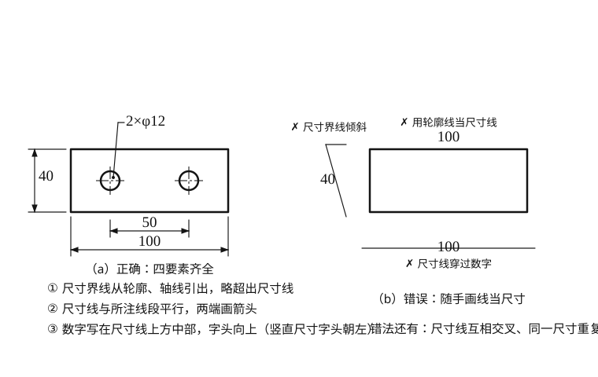

第五题要求：**根据给出的两个视图标注组合体尺寸，尺寸数字由图中 1:1 量取整数**，16 分。

这道题不考画图，只考「该标什么、不该标什么」。它看起来最简单，实际是整张卷子里最容易磨时间的一题：标完要逐个检查有没有重复、有没有漏。

## 四个要素

一个尺寸必须完整：尺寸界线、尺寸线、箭头、数字。

<figure class="fig">
  
  <figcaption>图 7-1　左边是规范画法，右边的三种错法在卷面上非常常见</figcaption>
</figure>

- **尺寸界线**：细实线，从轮廓线、轴线或对称中心线引出，一般与尺寸线垂直，并**超出尺寸线 2~3 mm**；也可以用轮廓线、轴线本身代替；
- **尺寸线**：细实线，与被注线段平行，**不能用其他图线代替，也不能画在轮廓线的延长线上**；几条尺寸线平行时，间距要均匀（约 7~10 mm），小尺寸在里、大尺寸在外；
- **箭头**：画在尺寸线两端，箭头尖端正好指到尺寸界线；尺寸太小时，箭头可以画在尺寸界线外侧，数字写在中间；
- **数字**：写在尺寸线上方中部。水平尺寸字头向上，竖直尺寸字头朝左。单位是 mm，**不写单位、不写 mm**。

## 标什么：三类尺寸

标注组合体，本质上是在回答三个问题：

1. **每一块有多大** → 定形尺寸（长、宽、高、直径、半径）；
2. **每一块在哪里** → 定位尺寸（孔心距、凸台到端面的距离）；
3. **整体多大** → 总体尺寸（总长、总宽、总高）。

标注前先定**尺寸基准**：长、宽、高三个方向各选一个——通常选底面、端面、对称面或轴线。所有定位尺寸都从基准出发，不要东一个西一个。

顺序建议：

1. 先标总体尺寸（总长、总宽、总高），把「框架」定住；
2. 再按基本体逐块标定形尺寸；
3. 最后标定位尺寸（孔、槽、凸台的位置）；
4. 检查重复与遗漏。

有一条容易忽略的规则：**当总体尺寸等于各段尺寸之和时，总体尺寸不再标注**（否则就是重复）。但圆弧半径一定要单独标，因为半径不能靠相加得到。

## 常见错误清单

- **用轮廓线当尺寸线**：把「100」直接写在顶边上，没有尺寸界线，也没有箭头；
- **尺寸线交叉**：两条尺寸线互相穿过，或者穿过尺寸数字；
- **尺寸线画在轮廓线的延长线上**：看起来像轮廓线的一部分，判卷直接算错；
- **重复标注**：总长标了，各段又全部标一遍，且加起来还等于总长；
- **漏标定位尺寸**：孔画出来了，但没标孔心位置，加工时无法确定；
- **标注在虚线上**：尽量把尺寸引到实线轮廓上；
- **数字方向错**：竖直尺寸的数字横着写。

## 顺带记住：螺纹与粗糙度

有些卷子（比如工程制图 A）会考螺纹和表面粗糙度，记住这几个符号就够用：

- **M20**：粗牙普通螺纹，公称直径 20，右旋（右旋不注）；
- **M20×1.5**：细牙普通螺纹，螺距 1.5；左旋要加注 `LH`，写成 `M20×1.5LH`；
- 螺纹的大径画粗实线，小径画细实线（约 3/4 圈），螺纹终止线画粗实线；
- **Ra 1.6**：表面粗糙度，单位 μm，符号尖端指向被加工表面，可标在轮廓线或延长线上；
- 同一零件各表面的粗糙度要求不同时，分别标注；其余相同则写「其余」。

## 自查清单

- 尺寸界线和尺寸线分别用什么线？尺寸界线要超出多少？
- 水平尺寸和竖直尺寸的数字，字头分别朝哪？
- 定形、定位、总体尺寸各解决什么问题？什么情况下总体尺寸不标？
- 尺寸基准一般选在哪里？
- 螺纹 `M20×1.5LH` 各部分是什么意思？

  
下一步 · 练一练

  
七章看完，去题库里把五个考点各刷一遍

  
164 道题按读图、截交相贯、剖视、尺寸、投影分组，含 37 道多选题和 9 道原卷图文题。错题会自动收集，考前只刷错题就够。

  <a class="cta-btn" href="../apps/quiz-gt.html">进入工程制图刷题 →</a>

